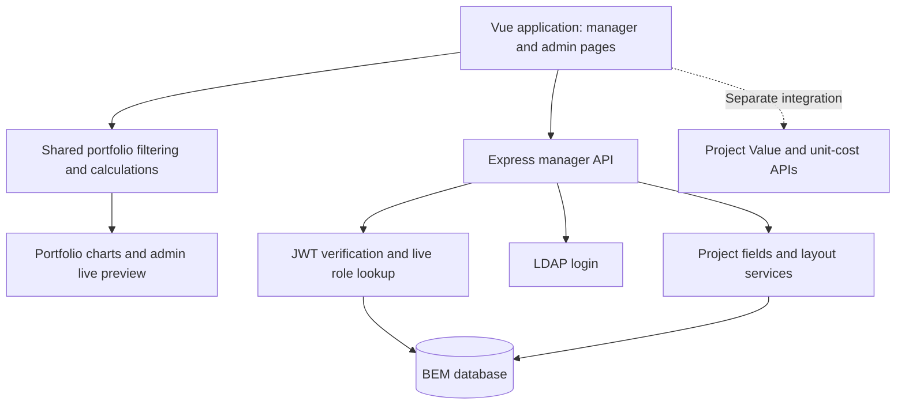

# AI@BEM Portal — Project Portfolio and Value Management

AI@BEM Portal is a Vue 3 application for maintaining project records, tracking cumulative yearly savings and milestones, reviewing portfolio performance, and configuring shared dashboards without routine developer changes.

The application combines **Manager Yearly Tracking**, **Portfolio Overview**, **Visualisation Management**, administrative configuration, and a separate **Project Value** interface for monthly KPI records and dated unit-cost rates.

**Documentation updated: 3 November 2026.** This README reflects the inspected manager/backend source, the modular frontend, visualisation enhancements completed through 29 October 2026, and the AI@BEM Portal branding update. It supplements the earlier [technical documentation](AI_BEM_Technical_Documentation.docx), dated 14 October 2026.

The application name is **AI@BEM Portal** across login, landing, dashboards and browser tabs. Functional names such as Project Tracking, Portfolio Overview, System Administration and Project Value remain descriptive module labels. Existing route paths, API endpoints, database names, storage keys and package identifiers are unchanged.

> The supplied feature bundles extend an existing application and BEM database. They are not a replacement for the complete repository, dependency lockfile, original core database schema, or production configuration. In particular, the manager-focused `server.js` does not implement the separate Project Value, Project Master and unit-cost APIs.

## Contents

- [1. Application capabilities](#1-application-capabilities)
- [2. Architecture and technology](#2-architecture-and-technology)
- [3. Source organisation](#3-source-organisation)
- [4. Prerequisites](#4-prerequisites)
- [5. Environment configuration](#5-environment-configuration)
- [6. Database setup and structure](#6-database-setup-and-structure)
- [7. Local development](#7-local-development)
- [8. Authentication and permissions](#8-authentication-and-permissions)
- [9. Project records, dates and audit behaviour](#9-project-records-dates-and-audit-behaviour)
- [10. Portfolio calculation rules](#10-portfolio-calculation-rules)
- [11. Sites, master data and filters](#11-sites-master-data-and-filters)
- [12. Visualisation Management](#12-visualisation-management)
- [13. Layout persistence and compatibility](#13-layout-persistence-and-compatibility)
- [14. API reference](#14-api-reference)
- [15. Important modules and functions](#15-important-modules-and-functions)
- [16. Project Value and unit-cost integration](#16-project-value-and-unit-cost-integration)
- [17. Production deployment](#17-production-deployment)
- [18. Operations, backups and snapshots](#18-operations-backups-and-snapshots)
- [19. Verification and acceptance testing](#19-verification-and-acceptance-testing)
- [20. Troubleshooting](#20-troubleshooting)
- [21. Extension and maintenance guidelines](#21-extension-and-maintenance-guidelines)


## 1. Application capabilities

### Manager Yearly Tracking

- Create and update project metadata, cumulative yearly savings, operational KPIs and milestone dates.
- View and filter a project grid, select visible columns and inspect project metadata below the grid.
- Display validated project URL links as clickable hyperlinks.
- Maintain optional custom fields with configurable types, dropdown categories and form sections.
- Review project history, custom-field/date audit records and administrator global history.
- Display planned project timelines and recorded PMO-gate transition counts.
- Export the rendered manager view to PDF.

### Portfolio Overview

- Display executive cumulative-value/project-count cards, pillar summaries, actual/target tables and trends.
- Display configurable category charts, tables, summary cards and mixed Bar + Line comparisons.
- Exclude On-Hold and Cancelled projects from portfolio values and counts.
- Apply global category selections together with individual chart filters.
- Inspect source projects through chart/table drill-downs and the accessible exploration controls.
- Apply the layout saved by an administrator through **Refresh Layout**.

### Administration

- Manage application access rights.
- Configure master-data dropdown categories, including Sites.
- Maintain annual Site targets.
- Create optional project columns and edit their supported display/input metadata.
- Configure shared visibility of optional project fields.
- Design, preview and save the shared portfolio layout.

### Visualisation editor

- One **Add Chart** chooser for charts, tables and summary cards.
- Template-first table creation and configurable row/column axes.
- A guided metric builder with approved aggregations.
- Optional category grouping and optional per-chart filters.
- Configurable category colours, number formats, labels and legends where supported.
- Live preview, drag-to-reorder, corner resizing and non-drag layout controls.
- Session Undo/Redo, duplicate, hide/show and standard-layout restoration.
- A sticky action bar with draft status and Save Layout.
- Field-level validation and navigation to the setting needing correction.
- Automatic reveal/focus of newly created items.
- A read-only **What this shows** card explaining the selected item's calculation and scope.

## 2. Architecture and technology

### Runtime overview



The manager API returns project records and configuration. Shared frontend helpers derive portfolio values, tables and chart series from those records. The administrator preview and published portfolio reuse these helpers; they do not maintain separate business calculations.

The layout backend stores **configuration**, not chart results. Editing a visualisation does not modify project values. Project changes, target changes and published layout changes use different APIs and permission checks.

### Technology inventory

| Layer | Technology | Purpose |
| --- | --- | --- |
| Frontend | Vue 3, Options API | Page state, computed values, component composition and events |
| Build tooling | Existing Vue CLI project | Development server and production build |
| Tables | `vue-good-table-next` | Project/admin grids |
| Charts | `vue3-apexcharts` / ApexCharts | Category charts, trends, mixed charts and timelines |
| Browser PDF | `html2pdf.js` | Export of rendered page content |
| Project Value spreadsheets | `xlsx` | Client-side workbook export and import workflow support |
| Backend | Node.js, Express | JSON API, authentication, persistence and static hosting |
| Database driver | `mysql2` | Pooled queries and request-pinned transactions |
| Database | Existing MariaDB-compatible BEM deployment | Project records, targets, audit and settings |
| Authentication | `ldapjs`, `jsonwebtoken` | Directory login and JWT sessions |
| Scheduling | `node-cron` | Month-end project/KPI snapshots |
| Configuration | `dotenv`, `cors` | Backend environment loading and allowed browser origins |

Use the versions pinned by the complete application's `package.json` and lockfile. Exact installed dependency versions cannot be established from the modular source bundles alone. Database compatibility must include the MariaDB DDL used by the custom-field service, not merely compatibility with the `mysql2` driver.

## 3. Source organisation

Paths below describe the **installed application**, rather than the temporary folders used to distribute individual feature updates.

| Path | Responsibility |
| --- | --- |
| `src/views/ManagerYearlyTracking.vue` | Manager page shell and composition of logic/components |
| `src/views/manager-yearly/components/` | Project grid/forms, metadata, history, timeline and standard portfolio widgets |
| `src/views/manager-yearly/logic/` | API, state, fields, project writes, timeline, portfolio, history and preferences |
| `src/views/manager-yearly/styles/` | Manager layout, tables, dialogs and responsive rules |
| `src/views/AdminDashboard.vue` | Administration page shell and role-checked startup |
| `src/views/admin-dashboard/components/` | Admin tabs, visualisation inspector, preview and configuration controls |
| `src/views/admin-dashboard/logic/` | Users, master data, targets, columns, draft history, validation and preview logic |
| `src/views/admin-dashboard/styles/` | Administration and editor styles |
| `src/views/portfolio-layout/` | Shared aggregation, filters, Sites, metrics, tables, charts, formatting and drill-downs |
| `src/views/project-fields/` | Shared custom-field section and safe-link helpers |
| `src/views/ProjectValue.vue` | Separate monthly Project Value page shell |
| `src/views/project-value/components/` | Monthly grid, KPI analytics, unit costs, forms and history dialogs |
| `src/views/project-value/logic/` | Monthly APIs, forms, calculations, unit costs and exports |
| `server.js` | Manager API entry point; may be deployed inside `backend/` |
| `project-fields.js` | Backend custom-field definitions, DDL, value validation and audit |
| `portfolio-layout.js` | Backend layout catalogue, validation and revision-checked persistence |
| `trace.js` | Required request/query tracing integration |
| `project-fields-admin.html` | Optional standalone field-administration interface |
| `dist/` beside the running `server.js` | Production frontend assets served by Express |

The backend modules imported with `./...` must sit beside the running `server.js`. If the repository uses `backend/server.js`, the companion modules and production assets belong under that backend directory.

The page shells combine module exports such as `computed`, `methods` and `watch` using object spread. These functions execute with the page instance as `this`. Later entries override earlier entries with the same name. Review the complete composition before moving or renaming methods.

Parents own shared state; child components receive props and emit edits. `viewBindings.js` modules assemble explicit child bindings. Form drafts must clone nested custom values so Cancel cannot mutate the selected record.

> Install each entry component together with all its imported companion files. Copying only `AdminDashboard.vue`, `ManagerYearlyTracking.vue` or `portfolio-layout.js` is not a complete feature installation.

## 4. Prerequisites

Before starting, obtain:

1. The complete frontend/backend repository, including its dependency manifests and lockfiles.
2. A Node.js runtime compatible with those locked dependencies and the source's modern JavaScript features, including `Object.hasOwn`.
3. Access to the existing BEM database and its original core-table definitions.
4. A database engine supporting the migrations and custom-column creation statements used by this application.
5. An LDAP endpoint/base DN reachable from the backend host.
6. A runtime database account with the permissions required by the enabled features.
7. A migration/DBA account for reviewed schema changes.
8. The existing `trace.js`, application assets, router and deployment configuration.

Extension migrations do not create the original project, savings, metrics, access, configuration or target tables. A new empty database cannot be bootstrapped using migrations 001–006 alone.

## 5. Environment configuration

### Backend settings

Create the backend environment file using values approved for the target environment. Do not assume an `.env.example` was included in a feature bundle.

```dotenv
# Example only: replace placeholders before starting the server.
PORT=5001
JWT_SECRET=REPLACE_WITH_A_STRONG_PRIVATE_SECRET

LDAP_URL=ldap://YOUR_DIRECTORY_HOST:389
LDAP_BASE_DN=YOUR_DIRECTORY_BASE_DN

DB_HOST=YOUR_DATABASE_HOST
DB_PORT=3306
BEM_DB_USER=YOUR_APPLICATION_DATABASE_USER
BEM_DB_PASSWORD=YOUR_PRIVATE_DATABASE_PASSWORD
BEM_DB_NAME=YOUR_BEM_DATABASE

CORS_ORIGINS=http://localhost:8080
```

The LDAP URL above illustrates the variable format, not a transport-security policy. Use the directory transport and TLS configuration approved for the deployment.

| Variable | Behaviour |
| --- | --- |
| `JWT_SECRET` | Required; startup fails if missing |
| `PORT` | Defaults to `5001`; must be an integer from 1 to 65535 |
| `LDAP_URL` | Directory endpoint used during search/bind |
| `LDAP_BASE_DN` | Base DN for the one-level `uid` search |
| `DB_HOST` | Database host |
| `DB_PORT` | Defaults to `3306` |
| `BEM_DB_USER` | Runtime database user |
| `BEM_DB_PASSWORD` | Runtime database password |
| `BEM_DB_NAME` | Database/schema used by the manager services |
| `CORS_ORIGINS` | Additional comma-separated browser origins; the source also contains existing allowed origins |

The backend prefers an environment file adjacent to `server.js`, even when launched from a different working directory. Check the actual process path and configured database before troubleshooting or running migrations.

### Frontend API address

For local development, configure the existing Vue CLI environment files with an appropriate override, for example:

```dotenv
VUE_APP_API_URL=http://localhost:5001
```

Use the **server origin**, without an extra `/api` suffix: the frontend appends API paths itself. Use the real configured port if it differs from the example.

`VUE_APP_` values are embedded in browser assets. They must not contain database passwords, JWT secrets or other private credentials. Restart the development server after changing them; rebuild production assets when changing the production API address.

Manager/admin code can use an empty API base for same-origin requests. The inspected Project Value code interpolates the environment variable directly, so explicitly define a suitable value when that page is deployed; do not leave it undefined.

## 6. Database setup and structure

### 6.1 Setup sequence

1. Back up the database and record the currently deployed application version.
2. Confirm the host and `BEM_DB_NAME` used by the backend.
3. Obtain the original core schema and the extension migration files.
4. Review engine/version compatibility and apply the applicable migrations in order.
5. Verify storage engines, intended unique keys and singleton settings rows.
6. Start the backend and inspect `/api/health` readiness information.
7. Test actual project reads/writes and field-definition reads; startup readiness alone is not a complete schema audit.

An interactive database connection can be opened with the deployment's normal client, for example:

```bash
mariadb -h YOUR_DB_HOST -P 3306 -u YOUR_MIGRATION_USER -p YOUR_BEM_DATABASE
```

The `-p` flag prompts for the password instead of putting it in the command line. Once connected, confirm the database and inspect representative definitions:

```sql
SELECT DATABASE();
SHOW CREATE TABLE t_manager_project_master;
SHOW CREATE TABLE t_manager_project_fields;
SHOW CREATE TABLE t_manager_visualisation_layout;
```

These are inspection commands, not a replacement for the migration scripts.

### 6.2 Extension migrations

| Migration | Purpose | Important behaviour |
| --- | --- | --- |
| `001_project_fields.sql` | Field registry and separate custom-field audit table | Extends an existing schema; does not create all core tables |
| `002_project_field_dropdowns.sql` | Dropdown input metadata for older registries | Adds `input_mode` and `config_category` where needed |
| `003_actual_project_dates.sql` | Four explicit actual dates and an override mask | Existing unoverridden dates continue to derive from phase history |
| `004_column_visibility.sql` | Shared column-visibility singleton | Seeds row 1 without replacing existing choices |
| `005_visualisation_layout.sql` | Shared layout singleton | A null layout means use code defaults; existing saved layouts are preserved |
| `006_project_field_sections.sql` | Configurable form placement | Records legacy placement without replacing explicit section choices |

Earlier handovers distributed migrations 003 and 004 with `.sql.txt` filenames. Locate and review their complete SQL, then organise them as the normal migration files used by your deployment. A later frontend-only ZIP may not include every prerequisite migration.

Fresh copies of migration 001 already contain some columns added by later compatibility migrations. Check the actual scripts and installed schema rather than assuming that `CREATE TABLE IF NOT EXISTS` reconciles incompatible existing tables.

The custom-column service uses MariaDB-oriented statements including `NOWAIT` and `ALGORITHM=INSTANT`. If unsupported, investigate with the DBA; do not silently substitute a potentially blocking table rebuild in the live application.

### 6.3 Core tables

The following names and relationships are confirmed by application reads/writes. Their **physical types, foreign keys, nullability and indexes must be taken from the deployed DDL**.

| Table | Purpose | Important identity or lookup |
| --- | --- | --- |
| `t_manager_project_master` | Project metadata, dates and physical custom columns | `project_id` |
| `t_manager_yearly_savings` | Entered cumulative yearly balances | `project_id`, `savings_year` |
| `t_manager_metrics` | KPI values by reporting year | `metrics_id`; project/reporting-year lookup |
| `t_manager_comments` | Latest editable comment data | `comment_id`, `project_id`, `created_at` |
| `t_manager_project_phases` | Recorded gate periods | `project_id`, `phase_name`, start/end dates |
| `t_manager_history` | Core pre-update snapshots | `history_id`, `project_id`, `changed_at` |
| `t_manager_monthly_snapshots` | Period-labelled master/latest-KPI snapshots | Intended month/project identity for upsert |
| `t_manager_site_targets` | Annual Site targets | `site`, `target_year` |
| `t_bem_access` | Application access rights | `username` |
| `t_app_config` | Active master-data dropdown options | `category`, `value`, `is_active` |

The application expects effective uniqueness for project/year savings and Site/year targets. Snapshot upserts also depend on the intended unique key. Verify those constraints; do not infer that every expected relationship is enforced by a foreign key.

### 6.4 Main field mappings

| Database column | API property | Meaning |
| --- | --- | --- |
| `project_id` | `projectId` | Manager project identity |
| `project_name` | `projectName` | Project name |
| `project_status` | `projectStatus` | Current status and portfolio eligibility |
| `pillar` | `pillars` | Pillar category |
| `site` | `sites` | Comma-separated Sites or the `ALL` assignment |
| `current_pmo_gate` | `currentPmoGate` | Current PMO gate |
| `dtit_involved` | `dtitInvolved` | DTIT category |
| `ai_type` | `aiAaAType` | AI / AA / A category |
| `foak_noak` | `foakNoak` | FOAK / NOAK category |
| `target_g1_date` … `target_closed_date` | `targetG1Date` … `targetClosedDate` | Planned milestones |
| `actual_g1_date` … `actual_closed_date` | `actualG1Date` … `actualClosedDate` | Explicit actual-date overrides |
| `actual_date_override_mask` | Internal interpretation | Bits 1, 2, 4 and 8 distinguish explicit overrides |
| Savings rows by year | `year2025`, `year2026`, etc. | Dynamic properties containing entered cumulative balances |

The ten KPI mappings are `capacity_gain_value` → `capacityGainValue`, `capacity_gain_pct` → `capacityGainPercent`, `dl_value` → `dlValue`, `dl_equivalent` → `dlEquivalent`, `idl_value` → `idlValue`, `idl_fte` → `idlFte`, `yield_value` → `yieldValue`, `yield_gain_pct` → `yieldPercentGain`, `quality_value` → `qualityValue`, and `quality_cases` → `qualityCases`.

### 6.5 Extension tables

| Table | Important columns | Storage purpose |
| --- | --- | --- |
| `t_manager_project_fields` | `column_name`, `label`, `field_type`, `input_mode`, `config_category`, `form_section`, `state`, `display_order`, creation metadata, `last_error` | Describes and tracks setup of physical optional columns |
| `t_manager_project_field_history` | `audit_id`, `project_id`, `before_values`, `after_values`, `changed_by`, `changed_at` | JSON before/after audit for custom values and explicit actual-date edits |
| `t_manager_column_visibility` | `setting_id`, `hidden_fields`, `revision`, `updated_by`, `updated_at` | Shared hidden-field configuration in singleton row 1 |
| `t_manager_visualisation_layout` | `setting_id`, `layout_json`, `revision`, `updated_by`, `updated_at` | Shared dashboard/filter configuration in singleton row 1 |

The field registry's primary key is `column_name`. Its labels allow up to 120 characters; physical names allow up to 64. The custom audit table uses a `BIGINT UNSIGNED` auto-increment key and deliberately has no project foreign key so evidence can survive project deletion.

Visibility uses a text JSON list and a `BIGINT UNSIGNED` revision. Layout uses nullable `LONGTEXT` JSON and an `INT UNSIGNED` revision. JavaScript validates these JSON structures; the scripts do not use a native JSON-column schema constraint.

### 6.6 Custom field storage

Custom values are **real nullable columns on `t_manager_project_master`**, not rows in an entity-attribute-value table. Their API representation is nested under `customFields`.

| Type | Physical SQL type | Input/storage contract |
| --- | --- | --- |
| Text | `VARCHAR(255)` | Trimmed optional text |
| URL | `VARCHAR(2048)` | Validated full HTTP(S) URL |
| Number | `DECIMAL(18,4)` | Signed decimal; up to 14 integer digits and 4 decimal places |
| Date | `DATE` | Real `YYYY-MM-DD` date or null |
| Boolean | `TINYINT(1)` | Boolean API value; stored as 1/0 |

Decimal values remain strings at the API/audit boundary to preserve database precision. Chart arithmetic converts them to JavaScript numbers; see the calculation limitations below.

## 7. Local development

### 7.1 Integrate the source

Use the complete existing project. Merge the supplied frontend files into their installed `src/views` paths and keep the application entry point, router, assets and dependency manifests.

Install one consistent version of the shared `portfolio-layout` and `project-fields` directories. Avoid mixing a newer inspector with old chart helpers or a newer layout frontend with an older backend validator.

Place `project-fields.js`, `portfolio-layout.js` and `trace.js` beside the manager `server.js`. Preserve additional backend handlers already serving other application pages.

### 7.2 Install dependencies

In each directory that actually contains an application `package.json` and matching `package-lock.json`, install its locked dependencies using the repository's established workflow, typically:

```bash
npm ci
```

Do not run this in a source-only feature bundle. If the complete repository uses a different package manager or lockfile, follow that repository's workflow instead of generating a new dependency baseline.

### 7.3 Start the API and frontend

From the backend directory containing the configured server:

```bash
node server.js
```

From the Vue application's package root, in another terminal:

```bash
npm run serve
```

Verify the startup-reported addresses. The examples in this README use API port 5001; an existing environment may use a different configured port.

Inspect health with a browser or PowerShell:

```powershell
Invoke-RestMethod http://localhost:5001/api/health
```

The inspected manager build identifies its server family as `bem-project-fields-v7-visualisation-layout`. That string does not identify every later chart capability: also check the authenticated layout response's capability flags and returned catalogue.

### 7.4 First-use checks

- Confirm database/readiness messages and that the frontend calls the intended API.
- Sign in with an approved LDAP account.
- Have an authorised administrator grant the required application role; first-time directory users start as `pending`.
- Open the manager grid, refresh records and inspect a project's metadata.
- As an admin, check Master Data, Project Columns, Column Visibility and Visualisation Management.
- Confirm that a changed layout previews locally before being published.

## 8. Authentication and permissions

`POST /api/login` searches LDAP for the supplied user, binds using that user's credentials and then loads application access from `t_bem_access`. A first successful directory login creates a `pending` application account if needed.

JWTs expire after four hours in the inspected server. Protected requests verify the token and re-read the live database role, rather than trusting an old role claim indefinitely.

| Manager capability | Pending | Viewer | User | Admin |
| --- | --- | --- | --- | --- |
| Check a valid session | Yes | Yes | Yes | Yes |
| Read projects, field definitions, targets and saved layouts | No | Yes | Yes | Yes |
| Create/update projects and custom values | No | No | Yes | Yes |
| Read a project's history | No | Yes | Yes | Yes |
| Rename Project ID or delete projects | No | No | No | Yes |
| Read global manager history / force snapshots | No | No | No | Yes |
| Manage roles, master data, targets and field definitions | No | No | No | Yes |
| Publish shared visibility and visualisation layouts | No | No | No | Yes |

The server enforces permissions through `authenticateToken`, `requireAccess`, `requireEditAccess` and `requireAdmin`. Disabled/hidden frontend buttons are a usability layer, not the security boundary.

The inspected manager routes do not implement Site-level row permissions. Authorised readers receive project data and filter it in the interface. Likewise, shared column hiding is not a confidentiality mechanism: hiding a field does not remove its values from project APIs or calculations.

Browser pages use Bearer tokens stored in `localStorage`; this is not an HTTP-only-cookie session design. CORS limits browser cross-origin access but does not replace authentication. Production controls such as HTTPS, directory transport, request-rate limits, log redaction and security headers must be reviewed in the actual deployment; do not assume they are supplied by these modules.

## 9. Project records, dates and audit behaviour

### Project creation and updates

The manager Add workflow uses two requests:

1. `POST /api/manager-yearly` creates master metadata, supplied custom values and explicit dates.
2. `PUT /api/manager-yearly/:projectId` saves yearly values, KPIs and comments.

Each request has its own transaction. The complete two-request workflow is **not one atomic operation**. If the second request fails, the project can already exist. The frontend retains its created ID and retries the update instead of inserting a duplicate project.

Project transactions use a dedicated pooled connection. Reads/writes that need transactional locking use that pinned connection; failures roll back before connection release. Participating tables must use InnoDB.

The update path locks the master row and saves supplied fields. Unlike layout settings, normal project writes have no comparable revision token. A stale whole-record payload can overwrite other included values, so avoid treating normal project edits as fully conflict-checked collaborative editing.

### Blank, zero and omitted values

- Omitted custom values are unchanged; explicit null clears an optional custom value.
- Blank/null yearly savings updates are skipped, not used to erase an existing balance.
- Numeric zero is a real savings entry and can produce a negative annual increase.
- Blank/omitted comments do not clear the current saved comment through the normal update helper.
- Omitted KPI fields remain unchanged on an existing reporting-year row; rollover can carry omitted values from the latest recorded metric row.

### Actual-date overrides

Actual dates normally derive from the earliest recorded relevant gate start. Explicit edits set the corresponding override-mask bits. Clearing an actual date is a deliberate blank override, so the display does not immediately fall back to phase history.

Date corrections do not rewrite the recorded phase transitions. There is no current API operation to clear an override bit and resume automatic derivation; such a feature would require a separate audited contract.

### Audit and identity

- Core history captures a pre-update snapshot of selected metadata, KPIs and comment fields. It is not a complete version of every project property.
- Custom values and actual-date edits have separate JSON before/after audit records.
- History restore is a new normal write, not a database rollback or deletion of audit evidence.
- Admin ID rename updates the explicit core references and custom history handled by the server. Monthly snapshots are outside that rename list.
- Project deletion removes the listed core child/history records. Separate custom/date audit and monthly snapshots are not deleted by that handler.

Define retention and identity policies before adding new tables that reference manager Project IDs.

## 10. Portfolio calculation rules

### 10.1 Eligible projects

`portfolioRows()` normalises status case, surrounding whitespace and common space/dash/underscore variants. Normalised `onhold`, `cancelled` and `canceled` are excluded from portfolio values, counts and relevant category options.

These projects remain in the data-entry grid. Closed and blank-status projects remain eligible. Timeline and phase-velocity views have their own scopes and must not be assumed to use portfolio eligibility.

G2 includes G2.5. Closure is presented as **Operationalised** in the executive cards. Status and PMO gate are separate concepts.

### 10.2 Already-cumulative savings

Manager yearly entries are cumulative balances. Read the requested year's balance directly and sum it across eligible projects; do not accumulate balances across years again.

Annual increase uses the immediately preceding **calendar year**, not the preceding nonblank entry:

```text
Cumulative actual for year Y = sum of entered project balances for Y
Annual increase for a project = balance(Y) - balance(Y - 1)
```

The annual rule applies only when the current-year entry is present and valid; otherwise that project contributes zero annual increase.

| One project's entries | 2026 cumulative actual | 2026 annual increase |
| --- | ---: | ---: |
| 2025 = 400; 2026 = 1,000 | 1,000 | 600 |
| 2025 blank; 2026 = 1,000 | 1,000 | 1,000 |
| 2025 = 400; 2026 unentered | 0 | 0 |
| 2025 = 400; 2026 = 0 | 0 | -400 |

There is no automatic carry-forward of an unentered current-year balance. Adding 400 and 1,000 to report a 2026 cumulative value of 1,400 would be incorrect.

Executive value cards use cumulative balances; the standard pillar annual-value summary uses annual increases. They intentionally answer different questions.

### 10.3 Targets

Site target records are **annual amounts**, unlike entered project balances. Annual targets use that year's record; cumulative targets sum annual target records from the current baseline, **2025**, through the displayed year.

For annual Site targets of 300 in 2025 and 800 in 2026, the 2026 annual target is 800 and cumulative target is 1,100.

Only Site filters narrow targets. Project categories, statuses and PMO-gate filters narrow actual project values without inventing a target allocation. Tables do not allow site targets on project-category axes; a mixed chart using targets requires Year on the X-axis.

Changing the visible year window does not change the target accumulation baseline or the previous-calendar-year rule for actuals.

### 10.4 Guided numeric aggregations

| Calculation | Interpretation |
| --- | --- |
| Sum | Add the selected numeric value once per eligible project, or use the supported savings measure |
| Average | Mean of valid, nonblank numeric source values |
| Minimum | Lowest valid numeric source value |
| Maximum | Highest valid numeric source value |
| Project Count | Count each scoped project once; no numeric column required |
| Distinct Count | Count unique numeric source values, not projects or text categories |

Average, Minimum, Maximum and Distinct Count operate on registered numeric project columns. Real zeroes and negatives are included; blank/invalid values are excluded. Empty results display 0, including empty minimum/maximum results.

For values `10, 10, 20`, Project Count is 3 and Distinct Count is 2. Averages, extrema and distinct counts are not additive shares: use Bar, Column or Table rather than Pie, Doughnut or Treemap.

Overall table results and pooled **Other** results are recalculated from the scoped underlying projects. Do not sum category averages or category distinct counts to obtain an overall result.

### 10.5 Snapshots, KPI scope and precision

Custom numeric fields and the exposed project KPI columns are current saved values. Selecting a Year axis does not create historical snapshots; current values/counts repeat in each displayed year with explanatory notes.

The standard monetary KPI breakdown uses Capacity Gain Value, DL Value, IDL Value, Yield Value and Quality Value. It does not combine monetary amounts with quantities or percentages in that pie.

Number formatting applies at display time. For example, 1,200,000 with millions/one decimal displays as `1.2M`; currency-millions can display `$1.2M`. Choosing a currency code changes labels, not exchange rates or source amounts. Whole-number grid displays do not discard stored decimal precision.

Chart arithmetic uses JavaScript `Number` and therefore has floating-point limits. Do not treat a chart total as an exact-decimal reconciliation across the entire `DECIMAL(18,4)` range.

## 11. Sites, master data and filters

### Shared Site catalogue

`siteOptions.js` resolves options from:

1. Active configured Master Data Sites.
2. Sites used by eligible portfolio projects.
3. Sites present in target records, including Sites without eligible projects.

Names are trimmed, compared case-insensitively through uppercase normalisation, split on comma-separated assignments and deduplicated. `ALL` is a project-assignment marker, not a concrete Site option. A Site used only by excluded projects is not introduced by those projects alone; it can still appear if configured or backed by targets.

Master Data distinguishes **Configured** from **Missing from Master Data**. The latter means a Site is already used by project/target data but is not an active configured entry; it does not mean its values are invalid or hidden. **Configure Site** prefills the normal configuration workflow.

New project entry uses configured Site choices. Editing an existing project preserves a previously selected legacy Site with a warning so unrelated edits do not silently remove it.

### Filtering semantics

- Site matching uses exact comma-separated tokens: `MUA` does not match `MUA2`.
- A project assigned to `ALL` participates in a concrete Site selection.
- Portfolio counts do not duplicate a project merely because it matches multiple selected Site tokens.
- Grouping by Sites keeps a multi-Site project's **saved combination** as its category; it is not automatically exploded into one chart row per Site.
- Different filter rules combine with AND.
- Include accepts any listed value; Exclude rejects matches to any listed value.
- Individual chart filters intersect the current global selection; they do not replace it.
- Unassigned is distinct from All.

Administrators publish global **control definitions**—category, label, display style and order. Each reader's selected values are local to the page session, start from All, and are not published for everyone.

The Timeline uses the shared dynamic Site options and exact Site matching, but its project list remains separate from portfolio status exclusion. A matching Site catalogue does not imply identical Timeline and Portfolio project counts.

## 12. Visualisation Management

### 12.1 Standard workflow

1. Open **Visualisation Management** as an admin.
2. Click **Add Chart** and select a chart, table or summary card.
3. Create the selected item; the preview scrolls to it and focuses its title.
4. Use the inspector's **Data**, **Filters**, **Appearance** and **Layout** tabs.
5. Review **What this shows**, the live preview and any validation messages.
6. Use Undo/Redo, duplicate, resize or reorder as needed.
7. Click **Save Layout** to publish the draft.
8. Readers apply it through **Refresh Layout** or the normal layout-loading workflow.

Opening the chooser or cancelling it does not create an item. A completed add, drag or resize is grouped into the intended Undo step. Chart creation and inspection do not automatically publish changes.

### 12.2 Available presentations

| Presentation | Intended use | Important restriction |
| --- | --- | --- |
| Pie / Doughnut | A few additive nonnegative category results | Not for negative values or nonadditive metrics |
| Horizontal Bar | Compare categories, including long labels and decreases | Shared value formatting remains numeric |
| Column | Vertical category comparisons | Preserve meaningful units and negative values |
| Treemap | Compare nonnegative additive category sizes | Not for averages/extrema/distinct-count shares |
| Bar + Line | Compare two selected measures by Year or category | One shared scale; target line requires Year |
| Table | Read exact values with configurable axes and measures | No unallocated targets on category axes |
| Summary Card | One overall result | Grouping is not required |
| Standard trends | Existing actual/target presentation with supported variants | Preserve established default calculations and colours |

Different standard items support different type variants; not every presentation is available on every built-in item.

For mixed charts, admins choose **Bar value**, **Line value** and **X-axis**. Units must be compatible. Generic custom numeric fields do not carry full unit metadata, so administrators remain responsible for choosing genuinely comparable values even when the validator permits the combination. No secondary scale is implemented.

### 12.3 Tables

Table creation starts with templates such as Actual/Target by Year, category summaries, category/year comparisons and KPI overviews, plus supported custom setup. Existing tables can also be duplicated.

Configuration supports row/column axes, swapping axes, one to six values, value order, current-year or selected-year settings, sorting, category-row overall results, zero-row hiding, density and striping.

Changing an axis to a project category removes incompatible target measures and explains the change immediately. An inline Undo restores the previous configuration. If no compatible value remains, the editor can supply Project Count with an explanation.

Hiding zero rows is presentation-only; it does not remove their projects from an overall calculation. Different years and different measures are never added together as an overall table total.

### 12.4 Layout and feedback

- A compact sticky bar keeps Save Layout and Undo/Redo available with saved/unsaved/saving/conflict status.
- The selected chart is highlighted in the preview and identified in the inspector.
- Field-level errors identify the setting needing repair. Save/Review issues can select the item, open its tab and focus the affected setting.
- Drag handles reorder items; layout controls provide alternatives to dragging.
- Width presets correspond to 3, 4, 6 or 12 of the 12 grid columns. Heights use supported presets of 240, 280, 360 or 440 pixels; tables/cards fit content where applicable.
- Hide preserves configuration; Remove deletes a layout item, not its project data.
- **Layout actions** contains occasional restoration/reset actions rather than adding more primary buttons.
- Original DTIT, FOAK/NOAK, Pillar and actual/target colours remain the default unless an admin changes appearance.

### 12.5 What this shows

`ChartSummaryCard.vue` derives a plain-language description from the selected item's effective configuration. It explains metrics, grouping/axes, period/current-value basis, chart filters and temporary preview scope.

**Calculation & scope** expands to show complete rules and relevant calculation notes. Warnings cover unavailable settings, nonhistorical values on a Year axis, nonadditive composition metrics, and filters that narrow actuals without narrowing site targets.

The summary updates with edits, selection changes and Undo/Redo. It is read-only, admin-only, and is not stored in the layout JSON or added to Undo history.

### 12.6 Project drill-downs

Supported plot elements and numeric table values open a read-only source-project dialog. **Explore contributing projects** provides an explicit picker/button route, including access to values without an easily clickable plotted segment.

The dialog shows project identity, Site, status and unscaled source values, with search and 50-project pagination. Search changes the list being inspected, not the clicked aggregate. Rows with blank source values can remain visible for context while being excluded from applicable calculations.

Membership uses the same eligibility, global scope, chart filters, gate, category and year as the selected result. Other contains its pooled categories. Target values explain their Site-record source instead of inventing project target allocations.

Escape/Close returns focus on ordinary close; changing the relevant scope, widget or year closes stale details. Numeric values remain clickable without the previously removed underline styling.

## 13. Layout persistence and compatibility

### Saved model

The layout supports up to 30 uniquely identified items. Titles allow 1–100 trimmed characters; `{year}` is replaced at display time.

The stored JSON is now an object containing `widgets` and `globalFilters`. Legacy widget-array layouts still load; they receive the default Site control. A null `layout_json` uses code defaults. Invalid saved JSON produces a setup/service error rather than silently replacing the stored layout.

Example save body, using an **illustrative** revision:

```json
{
  "revision": 7,
  "globalFilters": [
    { "field": "sites", "label": "Site", "display": "buttons" }
  ],
  "widgets": [
    {
      "id": "projects_by_pillar",
      "kind": "grouped",
      "title": "Projects by Pillar",
      "visible": true,
      "width": 6,
      "height": 280,
      "chartType": "bar",
      "measure": "count",
      "groupBy": "pillars",
      "filterGate": "G3",
      "maxCategories": 10,
      "sort": "valueDesc"
    }
  ]
}
```

Use the revision returned by the latest relevant GET response, not the example number. Saving the widgets array replaces the shared layout contents; do not submit the example merely to test connectivity.

### Measure identifiers

| Identifier | Meaning |
| --- | --- |
| `count` | Project Count |
| `annualSavings` | Annual savings increase |
| `cumulativeSavings` | Selected-year cumulative balance |
| `field:dlValue` | Sum of a supported fixed numeric field |
| `field:customFields.cost_savings` | Sum of that registered numeric custom field, if it exists |
| `aggregate:average:field:customFields.cost_savings` | Approved non-sum aggregate of that numeric field |
| `aggregate:minimum:field:...` / `aggregate:maximum:field:...` / `aggregate:distinct:field:...` | Other approved numeric operations |
| `annualTarget` / `cumulativeTarget` | Target measures in supported tables/comparisons |

Sum retains the legacy field identifier; it is not saved as `aggregate:sum:...`. The backend accepts only allowlisted syntax, available fields and supported settings. It does not execute administrator-written JavaScript, SQL or arbitrary formulas.

### Revision checks and state boundaries

Layout and shared visibility saves use optimistic concurrency. An UPDATE succeeds only when its submitted revision still matches. A competing save returns 409. Preserve the local draft, load/reconcile the current version and reapply intended changes; never bypass the conflict by blindly overwriting with a newer revision.

| State | Shared/persisted? | Undo history? |
| --- | --- | --- |
| Chart type, data, filters, formatting, order and size | Published on Save Layout | Yes |
| Global filter control definitions | Published on Save Layout | Yes |
| Reader/admin-preview selected filter values | Local page-session values | No |
| Selected inspector item/tab and open disclosure | Local UI state | No |
| What this shows text and drill-down search | Derived/local UI state | No |
| Personal project-grid column choices | Browser/account/API-scoped local storage | Separate from layout history |

The layout response advertises capabilities such as `guidedMetricsEnabled`, `globalFiltersEnabled`, `tableConfigurationEnabled` and `flexibleComparisonEnabled`. Missing capabilities can mean the frontend is talking to an older backend. Changing a server version string does not enable a missing feature.

Deploy matching frontend/backend modules. Once new JSON formats or aggregate identifiers have been saved, rolling back only the backend can make the saved layout unreadable. Code-default changes also do not overwrite a nonnull administrator-saved layout automatically.

## 14. API reference

Protected calls use `Authorization: Bearer <token>`. JSON writes use `Content-Type: application/json`. Encode IDs and names placed into URL segments. Most error responses contain a `message` field.

### Manager API

| Method | Path | Access / purpose |
| --- | --- | --- |
| POST | `/api/login` | Public; LDAP login and application-role token |
| GET | `/api/check-auth` | Valid token; current session/live role |
| GET | `/api/health` | Public; build family, readiness and route metadata |
| GET | `/api/manager-yearly` | Reader; hydrated project list |
| POST | `/api/manager-yearly` | Editor; create master project data |
| PUT | `/api/manager-yearly/:projectId` | Editor; update supplied project values; rename is admin-only |
| DELETE | `/api/manager-yearly/:projectId` | Admin; delete listed project/core records |
| GET | `/api/manager-yearly/pipeline-velocity` | Reader; recorded phase-transition counts |
| GET | `/api/manager-yearly/:projectId/history` | Reader; project core history |
| GET | `/api/manager-yearly/history/all` | Admin; global core history |
| PATCH | `/api/manager-yearly/:projectId/custom-fields` | Editor; narrowly scoped custom-value update |
| GET | `/api/manager-yearly/:projectId/custom-fields/history` | Reader; separate custom/date audit |
| GET | `/api/manager-project-fields` | Reader; ready field definitions |
| GET / POST | `/api/admin/project-fields` | Admin; list setup state / create optional column |
| PUT | `/api/admin/project-fields/:columnName` | Admin; supported metadata settings, not arbitrary physical schema editing |
| GET | `/api/config/options` | Reader; active master-data categories/options |
| POST | `/api/config/options` | Admin; add configuration option |
| GET / PUT | `/api/admin/users` / `/api/admin/users/:username` | Admin; list users / update access right |
| GET | `/api/manager-site-targets` | Reader; annual target records |
| POST / PUT | `/api/manager-site-targets` | Admin; create/update Site/year target |
| GET | `/api/manager-column-visibility` | Reader; shared hidden-field settings |
| GET / PUT | `/api/admin/column-visibility` | Admin; settings/catalogue read and revision-checked save |
| GET | `/api/manager-visualisation-layout` | Reader; published widgets, controls and catalogue |
| GET / PUT | `/api/admin/visualisation-layout` | Admin; editor configuration and revision-checked publication |
| POST | `/api/admin/force-snapshot` | Admin; capture current data under a month label |
| GET | `/admin/project-fields` | Optional HTML shell; its protected data APIs still require permission |

Here, Reader means `viewer`, `user` or `admin`; Editor means `user` or `admin`.

A custom-only value write uses a narrow body such as:

```json
{
  "customFields": {
    "cost_savings": "16807.0000"
  }
}
```

The named field must already be registered and ready. Omitted values remain unchanged; use null to clear it. Do not send unrelated KPI/savings fields in a custom-only PATCH.

### Status interpretation

| Status | Typical meaning |
| --- | --- |
| 400 | Invalid JSON/body, field value or chart configuration |
| 401 | Missing token or rejected login credentials/user lookup |
| 403 | Invalid/expired JWT or insufficient application role |
| 404 | Missing project/field or unregistered API route |
| 409 | Duplicate identity, incompatible field setup or stale settings revision |
| 500 | Unexpected operation/directory/database failure |
| 503 | Missing/incompatible schema or unavailable required storage/service |

Manager/admin session wrappers can treat either 401 or 403 as a return-to-login condition. The separate Project Value wrapper distinguishes unauthorised actions from an expired session.

## 15. Important modules and functions

### Backend

| Module / function | Responsibility |
| --- | --- |
| `server.js` — `queryPromise()` | Traced query execution using a pinned request connection when present |
| `authenticateToken()` | JWT verification, username validation and live role reload |
| `saveMasterValues()` | Update supplied fixed metadata and maintain phase periods |
| `saveYearlyValues()` | Persist supplied valid yearly balances; distinguish blanks from zero |
| `saveMetrics()` | Save current reporting-year KPIs and preserve omitted values during rollover |
| `saveComment()` | Update the latest comment or create the initial one |
| `captureProjectHistory()` | Capture selected pre-update core state |
| `prepareActualDates()` / `saveActualDates()` | Validate explicit dates, write override bits and audit edits |
| `captureMonthlySnapshot()` | Upsert current master/latest-KPI state for a month label |
| `startServer()` | Start HTTP listener, readiness checks and the month-end scheduler |
| `project-fields.js` — `listReady()` | Return ready definitions after matching them to physical schema |
| `prepareValues()` / `applyValues()` | Validate supplied custom fields, write changes and record before/after evidence |
| `beginTransaction()` | Pin connection, require transactional engines and supply commit/cleanup handling |
| `addField()` | Advisory-locked, controlled nullable-column creation and verification |
| `updateField()` | Validate supported metadata edits without exposing raw SQL |
| `portfolio-layout.js` — `catalog()` | Build available built-ins, grouping fields and approved numeric measures |
| `normalizeWidgets()` | Strictly validate chart settings and nested configuration |
| `normalizeGlobalFilters()` | Validate saved global control definitions, not reader selections |
| `createPortfolioLayout()` | Compose layout reads, catalogue responses, revision-checked saves and routes |

### Frontend

| Module | Important responsibilities/functions |
| --- | --- |
| `manager-yearly/logic/api.js` | `apiFetch()`, `fetchTable()` and data/config refresh |
| `manager-yearly/logic/portfolio.js` | Standard executive/pillar/trend/KPI calculations |
| `manager-yearly/logic/timeline.js` | Safe tracking years, dynamic Site options and target-date ranges |
| `manager-yearly/logic/columnPreferences.js` | Account/API-scoped personal visibility loading/saving |
| `portfolio-layout/aggregation.js` | `portfolioRows()`, `annualValue()`, `widgetSelection()`, `aggregateMeasure()` and `widgetData()` |
| `portfolio-layout/metricDefinitions.js` | `metricDefinition()`, `metricValue()` and snapshot identification |
| `portfolio-layout/siteOptions.js` | `normalizeSite()`, `splitSites()` and `resolveSiteOptions()` |
| `portfolio-layout/globalFilters.js` | Clean viewer values, build rules and narrow Site target rows |
| `portfolio-layout/tableSettings.js` / `tableData.js` | Effective settings, validation, cells, totals and source memberships |
| `portfolio-layout/comparisonSettings.js` / `savingsComparison.js` | Effective mixed-chart series, axis/unit checks and comparison data |
| `portfolio-layout/presentation.js` | Shared number formatting and stable category colours |
| `portfolio-layout/ReactiveChart.vue` | Chart-wrapper update handling, including presentation-only changes |
| `portfolio-layout/drilldown.js` / `ProjectDrilldown.vue` | Exact source-project scopes and read-only inspection |
| `admin-dashboard/logic/visualisations.js` | Editor loading, item creation/selection, draft mutations and save orchestration |
| `admin-dashboard/logic/draftHistory.js` | Grouped history snapshots, Undo and Redo |
| `admin-dashboard/logic/editorFeedback.js` | Validation navigation, draft feedback and sticky-toolbar sizing |
| `admin-dashboard/logic/portfolioPreview.js` | Shared calculation context and new-item reveal/focus |
| `admin-dashboard/logic/chartSummary.js` | Derive human-readable calculation/scope descriptions without mutating widgets |
| `admin-dashboard/components/MetricBuilder.vue` | Guided choice of an approved operation and numeric source |
| `admin-dashboard/components/ChartSummaryCard.vue` | Compact What this shows card and expandable details |

Do not add a second copy of shared calculations inside a component merely to produce labels or preview values. Extend the common helper and test both preview and reader behaviour.

## 16. Project Value and unit-cost integration

`ProjectValue.vue` is a separate monthly-record interface. Its `project_code` is not automatically the same identifier as manager `projectId`. Define an explicit mapping before joining or reconciling these domains.

The frontend expects the following **separately supplied services**. They are not implemented by the inspected manager-only server, so their physical schemas, permissions and transaction guarantees must be verified in their own backend.

| API | Frontend expectation |
| --- | --- |
| `GET /api/project-master/options` | Project choices; falls back to `GET /api/project-master` |
| `GET / POST /api/project-values` | Read/create monthly KPI records |
| `GET /api/project-values/columns` | Column definitions when the data list is empty |
| `PUT /api/project-values/:metric_id` | Update/restore one monthly record |
| `GET /api/project-values/:metric_id/history` | Per-record history |
| `GET /api/project-values/history/all` | Global monthly-record history |
| `POST /api/project-values/import` | Multipart workbook upload; optional confirmed overwrite |
| `GET / POST /api/project-unit-cost` | Read/add dated unit-cost rates |
| `PUT /api/project-unit-cost/:project_code/:original_date` | Edit a rate using the original date and cost as write guards |
| `DELETE /api/project-unit-cost/:project_code/:effective_date` | Delete a rate using its original cost as a write guard |

Monthly rows expose fields such as `metric_id`, `project_code`, `project_name`, `month_end`, `capacity_improvement`, `yield_savings`, `people_productivity` and `quality_improvement`.

Unlike manager yearly balances, the inspected monthly chart logic accumulates monthly KPI amounts into running monthly/quarterly series. The quarterly mixed chart groups by project name, renders projects whose final running total is positive, and overlays a trend formed from those rendered series. Identical names can therefore combine; excluded nonpositive project series and rounding mean that overlay is not necessarily the full-precision total of every filtered record.

Unit-cost rates use `project_code`, `effective_date` and `avg_unit_cost`. The comparison is **previous cost minus latest cost per unit**. A positive result is a reduction; a negative result is an increase. Percentage change is unavailable when the previous cost is zero. These rate comparisons do not calculate realised total savings from production volume.

Spreadsheet export uses filtered rows when present but falls back to all rows when the filtered array is empty. Be aware that a zero-match filter can therefore export all records in the inspected implementation. PDF export captures rendered content, not a complete database/audit export.

## 17. Production deployment

### Release checklist

1. Identify the actual running server entry point, environment file, API address and database.
2. Back up sources, environment configuration, database schema/data and shared settings.
3. Review/apply required migrations before enabling dependent backend functionality.
4. Deploy matching backend modules, preserving any additional existing services.
5. Merge all required Vue components, logic and shared helpers.
6. Set the intended production `VUE_APP_API_URL` before building.
7. Build from the complete frontend project:

   ```bash
   npm run build
   ```

8. Deploy the generated assets into `dist/` beside the running `server.js`, or use the established external static-host setup.
9. Restart the intended backend process and verify its health/readiness.
10. Validate API JSON responses, login/roles, direct page navigation, save/reload and portfolio calculations in the deployed browser.

The source already contains static serving and a non-API SPA fallback:

```js
app.use(express.static(DIST_DIR));
app.get(/^\/(?!api(?:\/|$)).*/, /* send dist/index.html */);
```

This is an excerpt explaining routing, not replacement code. Keep all registered API routes and the JSON `/api` 404 handler **before** the SPA fallback. Missing frontend assets produce a setup-oriented 503 response rather than a functioning page.

An IIS/reverse proxy, if used, must preserve Authorization headers and route `/api` requests to the intended service. TLS, bindings, rewrite rules and process supervision are deployment responsibilities; no exact IIS configuration or process-manager command is established by these source bundles.

Replacing a `.vue` file does not update an already deployed production build. Rebuild/redeploy `dist`. Replacing a backend module does not update an existing Node process until that process restarts.

## 18. Operations, backups and snapshots

### Health and tracing

`/api/health` reports the server family and last storage-probe results. Checks can initially have `checked: false` because the listener starts before asynchronous probes finish. A feature flag means the code exists; a corresponding readiness object reports the last storage check, not a guarantee that every future transaction will succeed.

API responses expose `X-Trace-Id` and `X-BEM-Server-Version` for request correlation. `queryPromise()` traces a shortened SQL template and metadata; `trace.js` determines destinations, retention and redaction. Preserve that integration when refactoring the server.

### Snapshot schedule

The scheduler runs daily at `23:55` using `55 23 * * *`, checks whether tomorrow is in a new month, and captures only on the last day. No explicit cron timezone is supplied; the backend process/host timezone applies.

Snapshots contain current master identity/status/gate and the latest available KPI values. They do not capture all yearly savings, custom columns or comments. A forced capture for a historical month labels **current data** with that month; it does not reconstruct past state.

There is no automatic catch-up for a missed month-end run. Multiple backend processes each schedule their own job, so intended snapshot uniqueness and deployment scheduling need to be verified.

### Backup and recovery scope

Back up these together:

- Core database data and DDL.
- Physical custom master-table columns and their registry/audit tables.
- Layout/visibility singleton records and revisions.
- Application source/build versions and migration records.
- Environment/trace/proxy configuration, handled as sensitive operational material.

Do not restore only the custom registry or only the master-table schema: that creates definition/physical-column drift. DDL creation is not a normal rollbackable project transaction. The field service serialises setup with an advisory lock, keeps incomplete setup in `creating` with `last_error`, and verifies the physical column before marking it ready.

Repair corrupt settings or incomplete schema through a reviewed process. Setting layout JSON to null deliberately restores code defaults; it is not a harmless diagnostic step. Do not delete settings or drop columns to suppress an error.

## 19. Verification and acceptance testing

The latest feature-workflow verification record, completed on **29 October 2026**, contains **294 passing behaviour checks**, including:

- Portfolio exclusions, cumulative/annual differences and target baselines.
- Approved numeric operations, missing/zero/negative values and distinct-count semantics.
- Nonadditive overall/Other recomputation.
- Dynamic Sites, exact matching, target-only Sites and legacy configuration repair.
- Global/chart filter intersection and separation of definitions from viewer values.
- Table creation, axis changes, mixed-chart selectors and saved reader parity.
- Drill-down memberships, target explanations, search, pagination and focus.
- Editor validation, Undo/Redo, drag/resize grouping and revision conflicts.
- New-item reveal/focus and plain-language summaries.
- Compilation of maintained Vue templates and companion import resolution.

Those checks use a source-workflow harness with mocked API/database/LDAP/chart integrations. They do **not** establish a full installed Vue CLI/ESLint build, real ApexCharts browser rendering, live directory authentication, live MariaDB DDL behaviour or production deployment.

Use the complete repository's manifest to identify available validation scripts:

```bash
npm run
```

Run its defined lint/test/build tasks. Do not assume `npm test` or a particular lint command exists merely because this README describes automated verification. The source-workflow QA harness is separate from the frontend-only feature ZIP.

### Recommended acceptance cases

| Area | Check |
| --- | --- |
| Roles | Viewer cannot edit; user cannot change shared settings; pending cannot read projects |
| Numbers | 2025 = 400 and 2026 = 1,000 gives cumulative 1,000 and annual 600 |
| Missing data | Unentered current year differs from explicit current-year zero |
| Status | Large On-Hold/Cancelled values do not affect portfolio totals |
| Sites | Exact `MUA`/`MUA2` separation; ALL assignment; configured-only and target-only choices |
| Metrics | Zero/negative/blank values; distinct values `10, 10, 20`; weighted overall average |
| Tables | Category targets rejected/removed with explanation; transpose retains labels/values |
| Formatting | `1.2M`, currency, zero decimals, tooltip/table consistency and unchanged stored amounts |
| Drill-down | Scoped projects reproduce the clicked result; search does not alter its total |
| Drafts | Preview filtering/disclosure does not dirty/save; edits Undo/Redo; refresh behaviour understood |
| Publication | Save, reader Refresh Layout, reload and simultaneous-admin conflict |
| Accessibility | Keyboard tabs/disclosures, visible focus, non-drag controls and focus restoration |
| Deployment | Direct non-API route reload works; unknown API routes remain JSON 404 |

## 20. Troubleshooting

| Symptom | Likely cause / next check |
| --- | --- |
| New chart type/aggregation does not appear | Confirm matching frontend files, restart/rebuild, API base address, backend restart and capability flags |
| `Module not found` for a `.vue` helper | Install all companion files with exact directory structure/casing; do not copy only page shells |
| `series is defined but never used` in `comparisonPresentation.js` | Use the corrected companion file; `presentedComparisonOptions(widget, data)` does not need the unused third parameter |
| URL helper fails `no-control-regex` lint | Use the current `links.js`; control-character rejection uses character-code checks rather than the flagged regex |
| “Unexpected token <” / HTML instead of API JSON | Wrong API origin/proxy/route or an SPA fallback intercepting API calls |
| Frontend build missing / 503 on page navigation | Build the frontend and deploy assets to the running server's expected `dist` directory |
| Layout/visibility needs database setup | Check `BEM_DB_NAME`, migration tables, singleton row 1 and database permissions |
| Another admin changed the layout | Revision conflict; preserve intended changes and reconcile with a refreshed version |
| Project editing blocked by storage/engine checks | Inspect schema readiness, transaction-table engines and registered custom-column compatibility |
| New custom column remains incomplete | Inspect registry state/`last_error`, physical schema, ALTER support/permissions and competing DDL |
| Site appears in a filter but is not configured | It may be used by eligible projects or targets; use Master Data's Configure Site workflow |
| No Sites configured after a configuration error | Current code does not revive a hardcoded Site list; repair the configuration request/source |
| Project count differs between Timeline and Portfolio | These views have different status scopes; phase velocity also counts transitions, not distinct projects |
| Annual savings differs from cumulative cards | Annual is a calendar-year difference; cumulative cards read the selected year's balance |
| Target unchanged after selecting Pillar/gate | Targets are Site-level; non-Site filters narrow actual projects only |
| Custom numeric trend repeats every year | The column stores a current snapshot, not yearly historical observations |
| Formatting shows raw 1,200,000 instead of 1.2M | Check shared presentation helpers and wrapper updates, not only the saved layout backend |
| Personal columns revert after reload | Check authenticated username/API-scoped preference key and browser storage availability; admin hiding still takes precedence |
| Newly changed code has no production effect | Restart the correct backend and rebuild/redeploy frontend assets; verify router imports and response version headers |
| `/api/project-values` or unit-cost route returns 404 | The separate Project Value services are absent from the running manager-only backend |
| Snapshot labelled with an old month has current values | Force Snapshot captures current records under the requested label; it is not time travel |

For an issue report, include the affected workflow, user role, reproduction steps, HTTP status, trace ID, server version/capabilities and relevant readiness message. Do not include passwords, JWTs or private connection strings.

## 21. Extension and maintenance guidelines

### Adding an optional project column

Use the admin Project Columns workflow rather than adding ad hoc physical columns and assuming the frontend will discover them. Choose a validated lowercase name, supported type, label and form section. New columns default to **Project Details**, including new numeric fields; admins can select Yearly Data, KPIs or Timeline Milestones instead.

Only text fields support linked master-data dropdowns. A ready field must match its physical schema before being returned to readers. Type changes, arbitrary defaults/required constraints, column drops and physical renames are not normal metadata-edit operations.

URL fields must remain validated at backend and frontend boundaries. Safe metadata links use HTTP(S), reject embedded credentials/control characters and open with appropriate `noopener noreferrer` protection.

### Adding a metric or chart type

1. Define the numeric source, aggregation, grain, units, missing-value behaviour and historical meaning.
2. Extend the shared catalogue/allowlist and matching frontend choices only where supported.
3. Reuse shared eligibility/filter/target helpers; do not bypass them with component-local calculations.
4. Update strict saved-setting validation and capability flags if the persistence contract changes.
5. Verify old layouts, preview/reader parity, formatting-only updates, drill-down memberships and plain-language descriptions.
6. Preserve original category-to-colour mapping unless an explicit appearance override changes it.
7. Deliver every imported companion and identify whether a backend or migration change is actually required.

### Changing visibility or filters

Keep shared hidden fields, personal grid preferences and widget visibility separate. Preserve required identifiers and yearly values under the shared policy. Never use a display preference as a substitute for server-side data access.

Keep global control definitions separate from selected values. Changing preview scope, opening an inspector tab or expanding help/summary details must not add a layout save field or Undo step.

